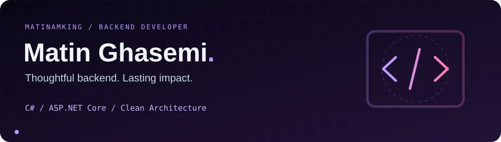
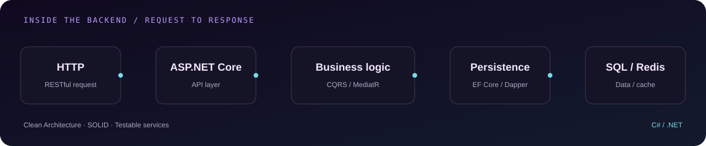
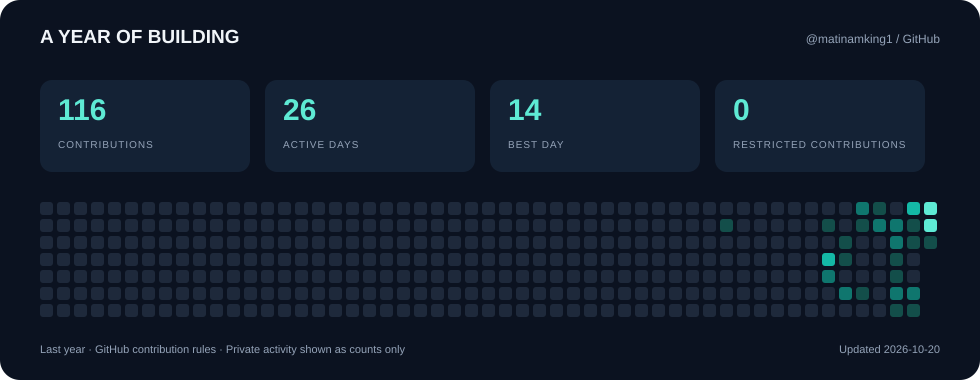
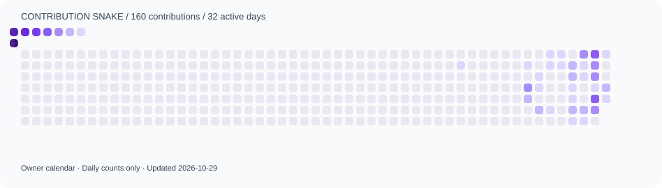

  
    
  
    
  
  
  
    
  

 

### 01 / The developer behind the code

I'm **Matin Ghasemi**, a backend developer based in **Isfahan, Iran**, with about two years of professional experience and a current focus on **C# and ASP.NET Core**.

I build business logic, RESTful APIs and data-processing services, with an emphasis on database performance, testable code and maintainable architecture.

- **Architecture:** Clean Architecture · SOLID · DDD · CQRS / MediatR.
- **Data:** EF Core · Dapper · SQL Server · MySQL · MongoDB · Redis.
- **Engineering:** automated testing with xUnit, backend optimization and scheduled processing.

<strong>سلام، من متین هستم 🇮🇷</strong>

 

من <strong>متین قاسمی</strong>، توسعه‌دهنده بک‌اند با حدود دو سال سابقه حرفه‌ای و تمرکز فعلی بر <strong>C# و ASP.NET Core</strong> هستم.
با RESTful API، EF Core، Dapper، CQRS، MediatR، Clean Architecture، DDD، Redis و تست‌نویسی خودکار کار می‌کنم.
در توسعه پلتفرم تأمین مالی جمعی <strong>iFund</strong> با بیش از ۱۰٬۰۰۰ سرمایه‌گذار فعال مشارکت داشته‌ام و سامانه پردازش خودکار اطلاعات بازار در <strong>آرتا فولاد</strong> را با وظایف زمان‌بندی‌شده و گزارش‌های PDF و Excel توسعه داده‌ام.
تمرکزم بر منطق کسب‌وکار، طراحی و بهینه‌سازی پایگاه داده و توسعه سرویس‌های قابل نگهداری و تست‌پذیر است.
  
<strong>تحصیلات:</strong> کارشناسی مهندسی نرم‌افزار، دانشکده فنی شهید محسن مهاجر اصفهان (۱۴۰۱–۱۴۰۴)؛ کاردانی نرم‌افزار، دانشگاه آزاد نجف‌آباد (۱۳۹۹–۱۴۰۱).

 

### 02 / My working toolkit

  

| Core stack | Data & persistence | Architecture & quality |
| :--- | :--- | :--- |
| **C# · ASP.NET Core** | SQL Server · MySQL · MongoDB | Clean Architecture · DDD · SOLID |
| RESTful APIs | EF Core · Dapper · Redis | CQRS · MediatR · xUnit |
| JavaScript · HTML · CSS | Query optimization · Indexing | Git · Docker · Automated testing |

Earlier web experience

PHP and Laravel are also part of my professional background; my current focus is the .NET ecosystem.

### 03 / Where my code has made an impact

| Experience | What I worked on |
| :--- | :--- |
| **[iFund ↗](https://ifund.ir/)** · Backend Developer | Crowdfunding platform serving **10,000+ active investors**; financial modules, CRM, APIs, dashboards and database optimization. |
| **Arta Foolad Aria Rad** · Full-Stack Developer | Automated market-data processing, configurable scheduled jobs, PDF / Excel reports and Telegram publishing. |
| **Giti** · Full-Stack Developer | Multi-site backend with a shared database, domain-scoped data access and collaboration request workflows. |

Experience and impact described in my portfolio; these are not public repository statistics.

### 04 / A year of building

GitHub activity over the last year. Private work appears as aggregate counts when available. Contributions follow GitHub's counting rules.

  

<picture>
  <source media="(prefers-color-scheme: dark)" srcset="./assets/snake-dark.svg" />
  <source media="(prefers-color-scheme: light)" srcset="./assets/snake-light.svg" />
  
</picture>

### 05 / Let's build something useful

Working on a .NET service, a data-heavy application or a backend challenge? **[Let's talk →](mailto:matin001037@gmail.com)**

---

Thoughtful backend. Lasting impact.

<!-- Maintainer setup and design references: docs/PROFILE-SETUP.md -->
